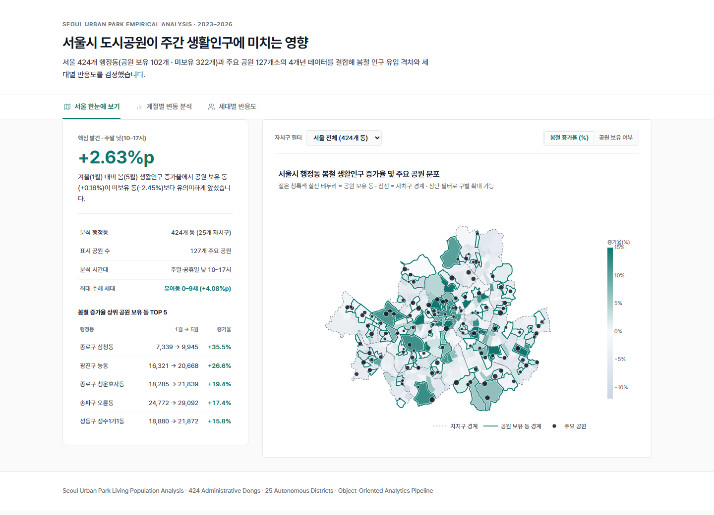
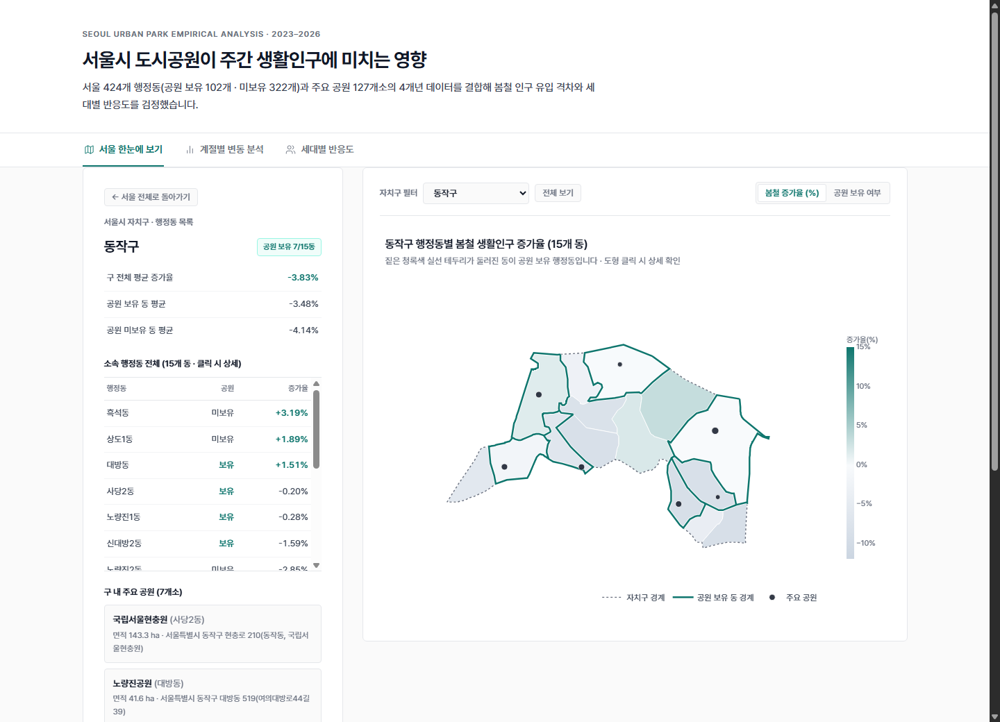

# 서울시 도시공원이 주간 생활인구에 미치는 영향

서울시 주요 공원 현황(127개소)과 2023\~2026년 1월·5월 행정동별 생활인구 데이터를 결합해, 공원 보유 여부에 따른 봄철 낮 시간대(10\~17시) 생활인구 변화와 세대별 차이를 비교하고 웹 대시보드로 시각화한 객체지향프로그래밍 팀 프로젝트입니다.

* 대시보드 배포 페이지: https://ladpect.github.io/seoul-park-oop4/
* 로컬 확인: 저장소를 받은 뒤 `docs/index.html`을 브라우저에서 열면 별도 서버 없이 바로 확인할 수 있습니다.

---

## 주요 기능

* **서울 전체 벡터 지도 (`서울 한눈에 보기`)**
  * 서울 424개 행정동, 25개 자치구 경계, 127개 주요 공원 위치를 SVG 지도로 표시합니다.
  * `봄철 증가율 (%)` 보기와 `공원 보유 여부` 보기 모드를 전환할 수 있으며, 공원 보유 동(102개)은 테두리로 별도 구분됩니다.
* **자치구 필터 드릴다운 및 상세 조회**
  * 상단 드롭다운에서 특정 구(예: 동작구, 노원구 등)를 선택하면 해당 구의 행정동과 공원만 화면에 맞춰 확대합니다.
  * 지도 위 행정동 도형이나 공원 마커를 클릭하면 좌측 패널에서 요일별(주말·평일·전체) 1월→5월 인구 변화, 4개년 연도별 추이, 5대 세대별 증가율, 공원 시설 정보를 볼 수 있습니다.
* **계절별·세대별 비교 차트 (`계절별 변동 분석`, `세대별 반응도`)**
  * 공원 보유 동과 미보유 동의 1월 대비 5월 생활인구 증가율 분포 박스플롯, 4개년 추이선, 5대 세대별 비교 막대그래프를 제공합니다.




---

## 분석 결과 요약

* **주제 1 — 공원 유무별 봄철(5월) vs 겨울(1월) 낮 생활인구 변화 (주말·공휴일 4개년 평균)**
  * 공원 보유 행정동(102개): `+0.18%`
  * 공원 미보유 행정동(322개): `-2.45%`
  * 증가율 격차: `+2.63%p` (2023년 `+1.62%p`, 2024년 `+2.50%p`, 2025년 `+3.29%p`, 2026년 `+3.09%p`로 4개년 모두 공원 보유 동이 높음)
* **주제 2 — 5대 세대별 공원 보유 동 vs 미보유 동 격차 (주말·공휴일 4개년 평균)**
  * 유아동(0~9세): `+4.08%p` (`+3.27%` vs `-0.81%`)
  * 청년층(20~39세): `+2.80%p` (`+1.70%` vs `-1.11%`)
  * 청소년(10~19세): `+2.74%p` (`+5.54%` vs `+2.79%`)
  * 중장년(40~59세): `+2.60%p` (`-0.77%` vs `-3.37%`)
  * 고령층(60세 이상): `+2.17%p` (`-3.46%` vs `-5.63%`)

---

## 사용 기술

* Python 3.13, uv
* pandas, NumPy
* Plotly (HTML / SVG 시각화)
* unittest

---

## 프로젝트 구조

```text
OOP/
├── data/
│   ├── README.md
│   ├── raw/
│   │   ├── park_dong_map.csv                 # 서울시 주요 공원 127개소 정보
│   │   ├── HangJeongDong_ver20260701.geojson # 원천 행정동 경계 GeoJSON
│   │   └── LPD/                              # 월별 생활인구 원천 CSV (Git 제외)
│   └── processed/
│       ├── daytime_weekend_pop.csv           # 주제 1 집계 데이터 (6,784행)
│       ├── daytime_age_pop.csv               # 주제 2 세대별 집계 데이터 (40,704행)
│       ├── seoul_dongs.geojson               # 서울 424개 행정동 경량 경계
│       └── seoul_gus.geojson                 # 서울 25개 자치구 경량 경계
├── preprocessing/
│   ├── newdata.py                            # 공통 로더, 달력, ParkMapper, 주제 1 전처리
│   └── extract_age_data.py                   # 주제 2 세대별 전처리 (상속 확장)
├── analysis/
│   ├── topic1_visualize.py                   # 서울 지도, 주제 1 분석기 및 차트
│   ├── topic2_visualize.py                   # 주제 2 분석기 및 차트
│   └── build_dashboard.py                    # DashboardBuilder (docs/index.html 생성)
├── tests/
│   ├── test_preprocessing.py                 # 전처리 및 ParkMapper 단위 테스트
│   └── test_analysis.py                      # 분석기 및 다형성 단위 테스트
├── docs/
│   ├── index.html                            # 통합 웹 대시보드 (GitHub Pages 소스)
│   ├── assets/                               # README 대시보드 스크린샷
│   ├── topic1/                               # 주제 1 개별 차트 및 stats_summary.csv
│   └── topic2/                               # 주제 2 개별 차트 및 stats_summary.csv
├── pyproject.toml
├── uv.lock
└── README.md
```

---

## 실행 방법

### 1. 의존성 설치

Python 3.13과 [uv](https://docs.astral.sh/uv/getting-started/installation/) 설치 후 프로젝트 루트에서 실행합니다.

```bash
uv sync --locked
```

### 2. 데이터 전처리 (원천 `data/raw/LPD/` 파일이 있는 경우)

```bash
uv run preprocessing/newdata.py
uv run preprocessing/extract_age_data.py
```

### 3. 시각화 및 통합 대시보드 생성

```bash
uv run analysis/topic1_visualize.py
uv run analysis/topic2_visualize.py
uv run analysis/build_dashboard.py
```

### 4. 단위 테스트 실행

```bash
uv run python -m unittest discover -s tests -v
```

---

## 팀원

* 정윤원 (`Ladpect`)
* 어승경 (`minmul07`)
* 김민재 (`CanelE452`)
* 박태준 (`parktj0807`)
* 송은빈 (`lullasia`)
